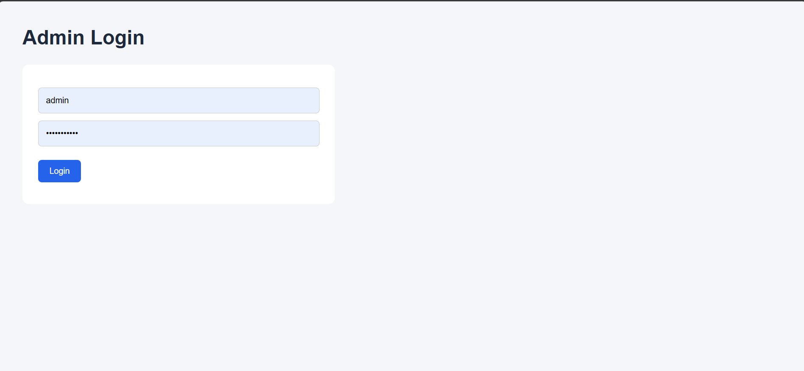
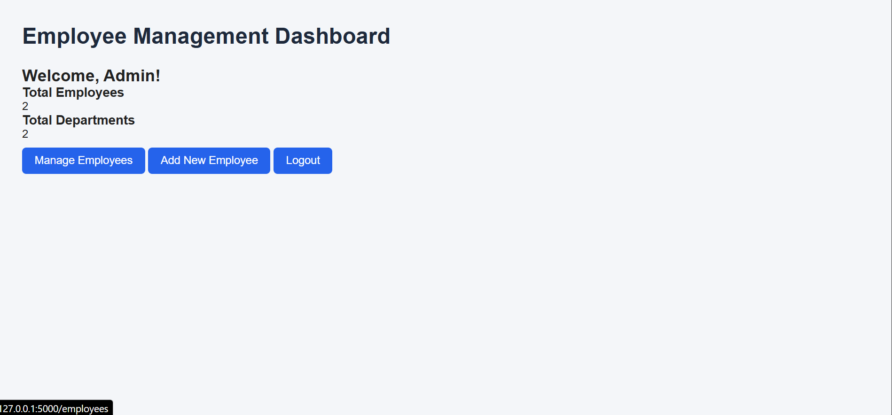
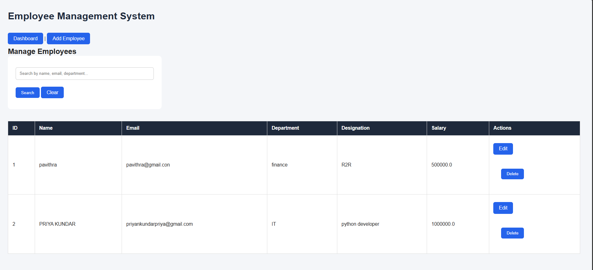
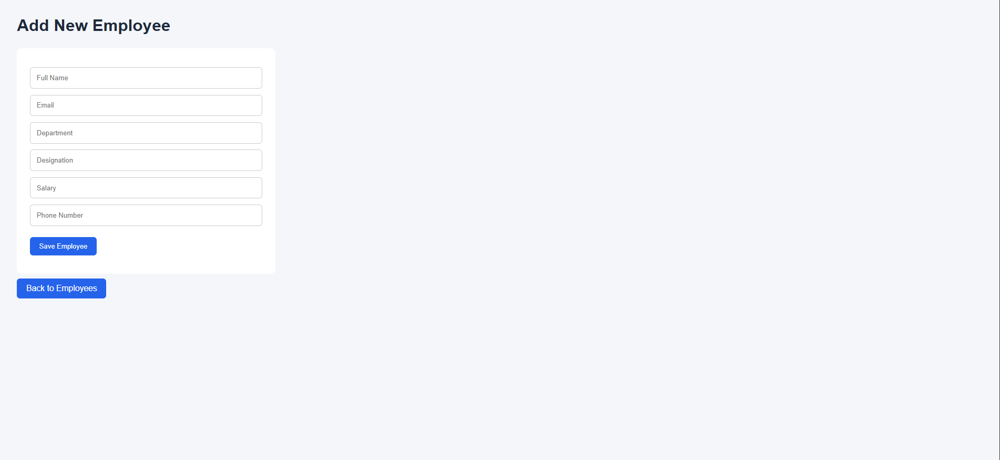

Employee Management System

A web-based Employee Management System built using Python and Flask to simplify employee record management.

Features

- Admin login and authentication
- Dashboard overview
- Add new employees
- View employee records
- Edit employee details
- Delete employee records
- Search employees

Technologies Used

- Python
- Flask
- HTML
- CSS
- SQLite / MySQL (depending on your configured database)

Project Structure

- "app.py" – Main Flask application
- "auth.py" – Authentication
- "config.py" – Database configuration
- "models.py" – Database models
- "routes.py" – Application routes
- "static/" – CSS and static files
- "templates/" – HTML templates

Installation and Setup

1. Clone the repository:
   
   "git clone https://github.com/priyankundarpriya-cmyk/Employee-Management-System.git"

2. Open the project folder.

3. Install dependencies:
   
   "pip install -r requirement.txt"

4. Run the application:
   
   "python -m flask --app app run --debug"

5. Open your browser at:
   
   "http://127.0.0.1:5000"

Purpose

This project demonstrates Python Flask development, database operations, CRUD functionality, and web application development.

Author

Priya N Kundar

## Project Screenshots

### Dashboard

### Add Employee

### Employee List

### Edit Employee

